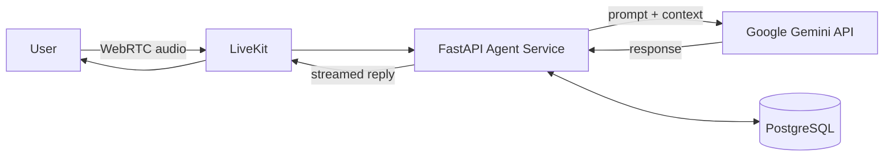

 

## 👋 About Me

I build backend systems and real-time data pipelines, with a growing focus on AI voice agents. I enjoy turning messy, high-volume data flows into clean, reliable APIs.

- 🔭 **Building:** AI Voice Agent Platform, a personal project using FastAPI, Google Gemini API, and LiveKit
- 🌱 **Learning:** advanced cloud data architectures, expanding into SAP S/4HANA Cloud environments
- 👯 **Collaborating:** open-source data engineering pipelines and complex backend projects
- 🤝 **Looking for help with:** scaling and optimizing real-time voice-streaming workloads
- 💬 **Ask me about:** backend development, AI integrations, custom API endpoints, and PostgreSQL schemas

## 🚀 Featured Project: AI Voice Agent Platform

A real-time voice agent platform that streams audio, reasons with an LLM, and responds with low latency.

**Stack:** `Python` · `FastAPI` · `Google Gemini API` · `LiveKit` · `PostgreSQL`

🔗 **[View repository →](https://github.com/Ahmedin-Jamil/YOUR-REPO-NAME)**

## 📌 More Projects

| Project | What it does | Stack |
| :-- | :-- | :-- |
| **[Project Name](https://github.com/Ahmedin-Jamil/REPO)** | One-line outcome: what problem it solves | `Kafka` `Spark` `Airflow` |
| **[Project Name](https://github.com/Ahmedin-Jamil/REPO)** | One-line outcome: what problem it solves | `Next.js` `Supabase` |
| **[Project Name](https://github.com/Ahmedin-Jamil/REPO)** | One-line outcome: what problem it solves | `Python` `Docker` |

## 💻 Tech Stack

**Languages** 

**Backend & APIs** 

**Data Engineering** 

**Databases** 

**Frontend** 

**Cloud, DevOps & Tools** 

## 🗣️ Languages I Speak

| Language | Level |
| :-- | :-- |
| Tigrinya | Native |
| Arabic | Native |
| English | Fluent |
| German | Basic |

## 📊 GitHub Stats

 

### 📫 Let's build something together

Open to backend, data engineering, and AI integration collaborations. 
**[Message me on LinkedIn](https://linkedin.com/in/jamil-alamin-ahmedin)** or **[send an email](mailto:jamil.alamin.ahmedin@gmail.com)**.

