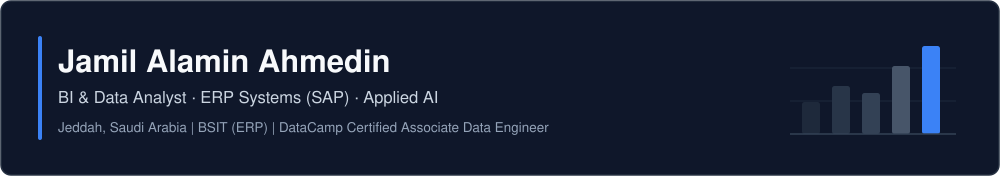
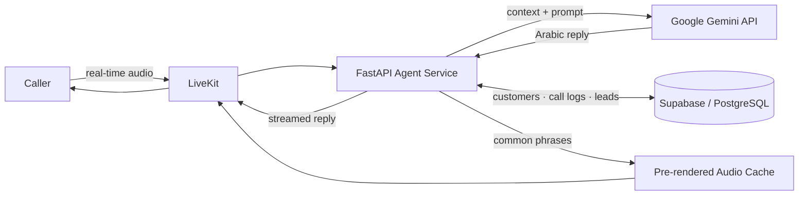

  

 

 

## 👋 About Me

I am an Information Technology graduate (**BSIT, Major in Enterprise Resource Planning**, University of the Cordilleras) and a **DataCamp Certified Associate Data Engineer** based in **Jeddah, Saudi Arabia**.

Most data problems start before a single chart is built. My ERP background taught me how real businesses generate data across sales, procurement, and operations. From there, I moved across the full data lifecycle: relational databases, cloud data warehousing, Business Intelligence, and practical AI integration.

- 📊 **Core Focus:** SQL (PostgreSQL), Power BI, Excel modeling, and Supply Chain / Retail KPI analytics
- 🏢 **Enterprise Foundation:** SAP S/4HANA concepts, SAP Fiori, SAP Analytics Cloud, and P2P / O2C / R2R lifecycles
- ☁️ **Data Architecture:** Medallion Lakehouse (Bronze / Silver / Gold), Azure Data Factory, Databricks, Snowflake, and dbt
- 🤖 **Applied AI:** Practical AI workflow routing and conversational Arabic voice prototypes grounded in structured databases

## 📌 Featured Projects

| Project | Summary | Core Stack |
| :-- | :-- | :-- |
| **🛒 [Azure E-Commerce Data Lakehouse](https://github.com/Ahmedin-Jamil/Azure-EcommerceProject)** End-to-End Cloud Pipeline | Medallion Architecture (`Bronze → Silver → Gold`) built on the Olist e-commerce dataset, moving raw transactional data into analytics-ready tables for BI reporting. | `Azure Data Factory` `ADLS Gen2` `Databricks` `Synapse` `Power BI` |
| **🚲 [ERP & CRM Wholesale Lakehouse](https://github.com/Ahmedin-Jamil/Databricks_Jamil-1)** Data Warehousing Project | Integrates multi-source ERP (customers, products) and CRM (orders, line items) wholesale datasets into clean analytical models on Azure Databricks. | `Databricks` `SQL` `PySpark` `Medallion Architecture` |
| **📈 [Real-Time Stock Market Data Pipeline](https://github.com/Ahmedin-Jamil/real-time-stocks-mds)** Modern Data Stack | Automated streaming pipeline pulling live market quotes via API into Snowflake and transforming raw tables with dbt for Power BI dashboards. | `Kafka` `Airflow` `Snowflake` `dbt` `Power BI` |
| **🎙️ [AI Voice Agent Platform](https://github.com/Ahmedin-Jamil/AI_VoiceAgent)** Applied AI Prototype | Arabic-speaking voice receptionist prototype for Saudi businesses, connecting real-time conversational AI to Supabase PostgreSQL for CRM lookup, call logs, and lead capture. | `Google Gemini API` `LiveKit` `FastAPI` `Supabase` `Next.js` |
| **🐾 Baguio Pet Boarding System** Capstone · Live Business Adoption | Online reservation and scheduling web system backed by PostgreSQL, adopted by a local business for live daily operations. | `PostgreSQL` `React` `Express.js` |
| **🧠 AI Student Support Platform** Internship @ OSAS | Relational Supabase/PostgreSQL schema, CBT/mood tracking workflows, and Hugging Face sentiment routing to direct urgent student concerns to university departments. | `PostgreSQL` `Supabase` `Hugging Face` |

### 🎙️ Applied AI Architecture Highlight: Arabic Voice Agent Prototype

## 💼 Experience

**AI & Full Stack Developer Intern** · Office of Student Affairs Services (OSAS), University of the Cordilleras 
Oct 2025 – Dec 2025 · Baguio City, Philippines

- Designed relational database schemas in Supabase (PostgreSQL) supporting confidential student reporting, mood tracking, and CBT tools
- Integrated Hugging Face sentiment and emotion APIs with automated alerts and routing for urgent student inquiries
- Analyzed operational bottlenecks and presented workflow improvement recommendations to department leadership
- 🏅 Awarded a **Certificate of Appreciation** for project contributions

**IT Support Volunteer** · Student-Course-Teacher Evaluation, University of the Cordilleras 
Nov 2025 · Baguio City, Philippines

- Provided technical support and troubleshooting during university-wide evaluation data collection across academic faculties

## 🛠️ Skills & Tools

**BI, Databases & Analytics** 

**Enterprise Systems (ERP)** 

**Data Warehousing & Cloud Pipelines** 

**Applied AI & Development Tools** 

## 🎓 Education, Certification & Training

**B.S. in Information Technology · Major in Enterprise Resource Planning (ERP)** 
University of the Cordilleras · Graduated December 2025 
Core Coursework: SAP Configuration (Fiori, ABAP), Enterprise Business Processes (P2P, O2C, R2R), Information Management, Data Mining, Statistical Design & Analysis

**Exam-Verified Certification**
- 🏆 **[Associate Data Engineer](https://www.datacamp.com/certificate/DEA0019372604408)** · DataCamp *(Sep 2026)*

**Professional Training & Workshops**
- **Building a Modern Data Warehouse Bootcamp** · Udemy *(Apr 2026)*
- **SAP Analytics Cloud Enablement Session** · SAP Southeast Asia & ASEAN Foundation *(May 2025)*
- **Managing Clean Core for SAP S/4HANA Cloud** · SAP Learning Hub *(Sep 2024)*

## 🗣️ Languages

| Language | Level |
| :-- | :-- |
| Arabic | Native |
| Tigrinya | Native |
| English | Fluent |
| German | A1 |

## 📊 GitHub Stats

 

### 📫 Connect

Open to opportunities and collaboration in **BI, Enterprise Data, Supply Chain Analytics, and Applied AI**. 
**[Connect on LinkedIn](https://linkedin.com/in/jamil-alamin-ahmedin)** · **[Send an Email](mailto:jamil.al.amin1100@gmail.com)**

