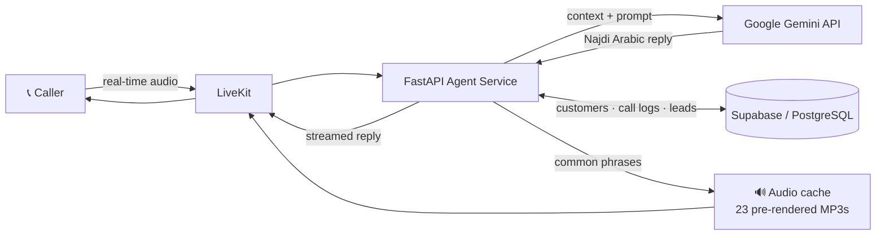

  

 

 
  

## 👋 About Me

I'm an Information Technology graduate (ERP major, University of the Cordilleras, Dec 2025) based in **Jeddah, Saudi Arabia**. I build backend systems and data pipelines that connect reliable APIs, databases, and AI. My current obsession is a real-time **Arabic voice agent** that answers customer calls.

- 🔭 **Building:** an AI Voice Agent Platform with FastAPI, LiveKit, Supabase, and the Google Gemini API
- 🌱 **Learning:** modern data warehousing, advanced cloud data architectures, and SAP S/4HANA Cloud
- 👯 **Collaborating:** open-source data engineering pipelines and complex backend projects
- 🤝 **Looking for help with:** scaling and optimizing real-time voice-streaming workloads
- 💬 **Ask me about:** custom API endpoints, PostgreSQL schemas, AI integrations, and building for Arabic-speaking users

## 🚀 Featured Project: AI Voice Agent Platform

An AI-powered voice agent that handles **inbound customer calls** in real time. It holds natural **Arabic conversations tailored to the Saudi Najdi dialect**, looks up customers by phone number, and captures leads automatically at the end of each call.

| | |
| :-- | :-- |
| **Highlights** | 12+ FastAPI REST endpoints for call-session management, CRM lookup by phone number, lead capture, and business knowledge retrieval · pre-rendered audio cache for instant playback of common phrases |
| **Stack** | `Python` `FastAPI` `Next.js` `LiveKit` `Supabase` `Google Gemini API` |
| **Status** | 🟢 In active development |

🔗 **[View the repository →](https://github.com/Ahmedin-Jamil/AI_VoiceAgent?tab=repositories)** <!-- TODO: replace with the direct repo link -->

## 📌 More Projects

| Project | What it does | Stack |
| :-- | :-- | :-- |
| **🐾 Baguio Pet Boarding System** Capstone | Online booking and reservation app for a local pet boarding business. **Adopted by the business for live operations** to organize customer bookings and pet stay schedules. | `React` `Express.js` `PostgreSQL` |
| **🧠 AI Student Support Platform** Internship @ OSAS | CBT-based mindset tools, weekly mood tracking, and confidential feedback. Hugging Face sentiment and emotion analysis flags urgent concerns, and context-aware routing sends feedback to the right department. | `Hugging Face` `Supabase` `Python` |
| **📈 Real-Time Data Streaming Pipeline** Guided technical project | Automated pipeline pulling live stock quotes via API, streaming them into Snowflake, and transforming raw data into clean analytical tables with dbt for Power BI dashboards. | `Kafka` `Airflow` `Snowflake` `dbt` `Power BI` |

## 💼 Experience

**AI & Full Stack Developer Intern** · Office of Student Affairs Services, University of the Cordilleras
Oct 2025 – Dec 2025 · Baguio City, Philippines

- Built an AI-integrated student support platform end to end, with relational schemas in Supabase (PostgreSQL)
- Integrated Hugging Face APIs for sentiment and emotion analysis with automated alerts for urgent student concerns
- Presented workflow improvement suggestions to department leadership
- 🏅 Received a **Certificate of Appreciation** for contributions to the project

## 💻 Tech Stack

**Languages** 

**Backend & APIs** 

**Data Engineering** 

**Databases & Cloud** 

**AI & Frontend** 

**Enterprise Systems & Tools** 

## 🎓 Education & Certifications

**B.S. Information Technology, Major in Enterprise Resource Planning** 
University of the Cordilleras · Graduated December 2025 
Coursework: SAP Configuration (Fiori, ABAP), Enterprise Business Process Lifecycles (P2P, O2C, R2R), Database Systems

| Certification | Issuer | Date |
| :-- | :-- | :-- |
| 🏆 **Associate Data Engineer** | DataCamp | Sep 2026 |
| Building a Modern Data Warehouse Bootcamp | Udemy | Apr 2026 |
| SAP Analytics Cloud Enablement Session | SAP Southeast Asia & ASEAN Foundation | May 2025 |
| Managing Clean Core for SAP S/4HANA Cloud | SAP Learning Hub | Sep 2024 |

## 🗣️ Languages

| Language | Level |
| :-- | :-- |
| Arabic | Native |
| Tigrinya | Native |
| English | Fluent |
| German | A1 |

## 📊 What I Write

### 📫 Let's build something together

Open to backend, data engineering, and AI integration collaborations. 
**[Message me on LinkedIn](https://linkedin.com/in/jamil-alamin-ahmedin)** or **[send an email](mailto:jamil.al.amin1100@gmail.com)**

