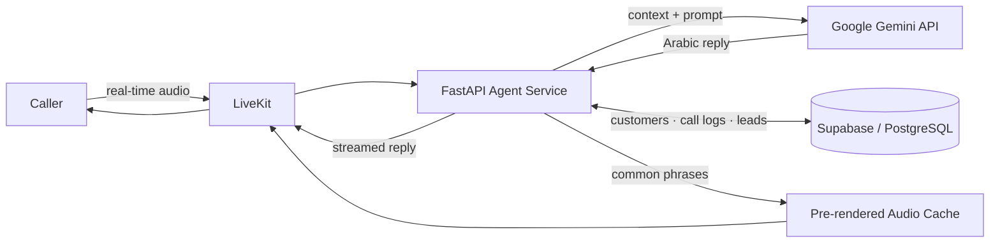

  <a href="https://linkedin.com/in/jamil-alamin-ahmedin"><strong>LinkedIn</strong></a> &nbsp;·&nbsp;
  <a href="mailto:jamil.al.amin1100@gmail.com"><strong>Email</strong></a> &nbsp;·&nbsp;
  <a href="https://www.datacamp.com/certificate/DEA0019372604408"><strong>DataCamp Certified Associate Data Engineer</strong></a>

---

### About

Information Technology graduate (**BSIT, Major in Enterprise Resource Planning**, University of the Cordilleras) and **DataCamp Certified Associate Data Engineer** based in Jeddah, Saudi Arabia.

Most data problems start before a single chart is built. My ERP background taught me how real businesses generate data across sales, procurement, and operations. From there, I moved across the full data lifecycle: relational databases, cloud data warehousing, Business Intelligence, and practical AI integration.

- **Core Focus:** SQL (PostgreSQL), Power BI, Excel modeling, and Supply Chain / Retail KPI analytics
- **Enterprise Foundation:** SAP S/4HANA concepts, SAP Fiori, SAP Analytics Cloud, and P2P / O2C / R2R lifecycles
- **Data Architecture:** Medallion Lakehouse (Bronze / Silver / Gold), Azure Data Factory, Databricks, Snowflake, and dbt
- **Applied AI:** Practical workflow routing and conversational Arabic voice prototypes grounded in structured databases

---

### Selected Projects

| Project | Overview | Stack |
| :-- | :-- | :-- |
| **[Azure E-Commerce Data Lakehouse](https://github.com/Ahmedin-Jamil/Azure-EcommerceProject)** End-to-End Cloud Pipeline | Medallion Architecture (`Bronze -> Silver -> Gold`) built on the Olist e-commerce dataset, transforming raw transactional data into analytics-ready tables for BI reporting. | `Azure Data Factory` `ADLS Gen2` `Databricks` `Synapse` `Power BI` |
| **[ERP & CRM Wholesale Lakehouse](https://github.com/Ahmedin-Jamil/Databricks_Jamil-1)** Data Warehousing Project | Integrates multi-source ERP (customers, products) and CRM (orders, line items) wholesale datasets into structured analytical models on Azure Databricks. | `Databricks` `SQL` `PySpark` `Medallion Architecture` |
| **[Real-Time Stock Market Data Pipeline](https://github.com/Ahmedin-Jamil/real-time-stocks-mds)** Modern Data Stack | Automated streaming pipeline ingesting live market quotes via API into Snowflake and transforming raw tables with dbt for Power BI dashboards. | `Kafka` `Airflow` `Snowflake` `dbt` `Power BI` |
| **[AI Voice Agent Platform](https://github.com/Ahmedin-Jamil/AI_VoiceAgent)** Applied AI Prototype | Arabic-speaking voice receptionist prototype for Saudi businesses, connecting conversational AI to Supabase PostgreSQL for CRM lookup, call logs, and lead capture. | `Google Gemini API` `LiveKit` `FastAPI` `Supabase` `Next.js` |
| **Baguio Pet Boarding System** Capstone · Live Business Adoption | Online reservation and scheduling web system backed by PostgreSQL, adopted by a local business for live daily operations. | `PostgreSQL` `React` `Express.js` |
| **AI Student Support Platform** Internship · OSAS | Relational Supabase/PostgreSQL schema, CBT/mood tracking workflows, and Hugging Face sentiment routing directing urgent student concerns to university departments. | `PostgreSQL` `Supabase` `Hugging Face` |

#### Architecture Highlight: Arabic Voice Agent Prototype

---

### Technical Stack

| Domain | Tools & Technologies |
| :-- | :-- |
| **BI, Databases & Analytics** | SQL, PostgreSQL, Power BI, Excel Modeling, Supabase |
| **Enterprise Systems (ERP)** | SAP S/4HANA, SAP Fiori, SAP Analytics Cloud, SAP ABAP, P2P / O2C / R2R |
| **Data Warehousing & Cloud** | Azure Data Factory, ADLS Gen2, Databricks, Azure Synapse, Snowflake, dbt, Kafka, Airflow |
| **Applied AI & Development** | Google Gemini API, Hugging Face, Python, FastAPI, JavaScript, React, Docker, Git |

---

### Experience

**AI & Full Stack Developer Intern** · Office of Student Affairs Services (OSAS), University of the Cordilleras 
Oct 2025 – Dec 2025 · Baguio City, Philippines

- Designed relational database schemas in Supabase (PostgreSQL) supporting confidential student reporting, mood tracking, and CBT tools.
- Integrated Hugging Face sentiment and emotion APIs with automated alerts and routing for urgent student inquiries.
- Analyzed operational bottlenecks and presented workflow improvement recommendations to department leadership.
- Awarded a **Certificate of Appreciation** for project contributions.

**IT Support Volunteer** · Student-Course-Teacher Evaluation, University of the Cordilleras 
Nov 2025 · Baguio City, Philippines

- Provided technical support and troubleshooting during university-wide evaluation data collection across academic faculties.

---

### Education & Credentials

**B.S. in Information Technology · Major in Enterprise Resource Planning (ERP)** 
University of the Cordilleras · Graduated December 2025 
Coursework: SAP Configuration (Fiori, ABAP), Enterprise Business Processes (P2P, O2C, R2R), Information Management, Data Mining, Statistical Design & Analysis

**Exam-Verified Certification**
- **[Associate Data Engineer](https://www.datacamp.com/certificate/DEA0019372604408)** · DataCamp *(Sep 2026)*

**Professional Training & Workshops**
- **Building a Modern Data Warehouse Bootcamp** · Udemy *(Apr 2026)*
- **SAP Analytics Cloud Enablement Session** · SAP Southeast Asia & ASEAN Foundation *(May 2025)*
- **Managing Clean Core for SAP S/4HANA Cloud** · SAP Learning Hub *(Sep 2024)*

---

**Languages:** Arabic (Native) · Tigrinya (Native) · English (Fluent) · German (A1)

Open to opportunities and collaboration in **BI, Enterprise Data, Supply Chain Analytics, and Applied AI**. Connect on [LinkedIn](https://linkedin.com/in/jamil-alamin-ahmedin) or via [email](mailto:jamil.al.amin1100@gmail.com).
